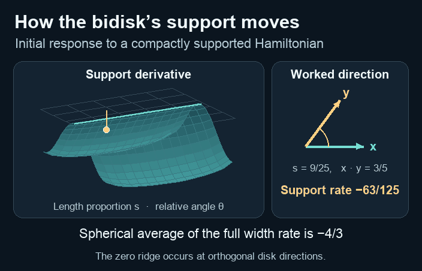

# A decreasing Hamiltonian direction for the Lagrangian bidisk

    

A compactly supported Hamiltonian gives the Lagrangian bidisk an initial mean-width derivative of **−4/3**, answering Ahn and Kerman's Question 1.13. The normalization averages both opposite support values over spherical probability.

[Read the paper](paper/manuscript.pdf) · [LaTeX source](paper/manuscript.tex) · [Proof outline](proof/PROBLEM_AND_PROOF.md) · [Replay](REPRODUCIBILITY.md)

## Why the support moves inward

For $B=\{(x,y)\in\mathbb R^2\times\mathbb R^2:\|x\|,\|y\|\le1\}$, choose $\chi$ smooth, equal to one near $B$ and compactly supported. The Hamiltonian is $H=\frac12\chi(\|x\|^2-\|y\|^2)(x\cdot y)$. In a direction $u=(a,b)$ with both components nonzero the unique support point is $(x,y)=(a/\|a\|,b/\|b\|)$. Its projected velocity is $-(\|a\|+\|b\|)(x\cdot y)^2$. The spherical mean of the angular square is $1/2$, and each component length has mean $2/3$.

For $x=(1,0)$, $y=(3/5,4/5)$ and $u=((3/5)x,(4/5)y)$, the support velocity is **−63/125** and the full directional width derivative is **−126/125**. The negative surface height measures support motion at time zero.

[Download the offline explorer ZIP](https://raw.githubusercontent.com/DannyExperiments/lagrangian-bidisk-hamiltonian-variation/refs/tags/v1.0.0/visualization/lagrangian-bidisk-hamiltonian-variation-explorer.zip), extract it, then open index.html. [Figure and regeneration guide](visualization/README.md)

## Source and scope

Ahn–Kerman's Proposition 1.12 gives local minimality under linear symplectic maps. Their Proposition 1.14, using Ramos's toric model of the bidisk, gives a smaller width at a global endpoint. Question 1.13 asks for the first variation along a smooth path through the identity in the full symplectomorphism group.

[Ahn–Kerman, Question 1.13](https://arxiv.org/pdf/2311.02870v3#page=4) · [Pinned Q1224](https://github.com/10m-u/open-problems-catalog/blob/ca8d4d44ba3db527f19f28928c240168f545ecfe/problems/mathematics/geometry-differential-geometry-part-1.md#q1224) · [Ramos](https://doi.org/10.1215/00127094-0000011X)

Internally reviewed, not peer reviewed. The partial Lean certificate verifies five algebraic statements. The paper proves the global flow and the analytic differentiation and integration steps.

[Mathematical audit](audits/public_safe_reports/MATHEMATICAL_AUDIT.md) · [Literature audit](audits/public_safe_reports/LITERATURE_AUDIT.md) · [Scope](CLAIM_SCOPE_AND_LIMITATIONS.md) · [AI disclosure](AI_DISCLOSURE.md)

[Version v1.0.0](https://github.com/DannyExperiments/lagrangian-bidisk-hamiltonian-variation/releases/tag/v1.0.0) · [Version DOI](https://doi.org/10.5281/zenodo.24574100) · [Citation](CITATION.cff)
